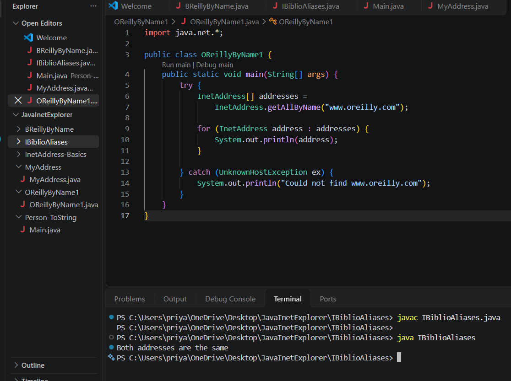

# IBiblioAliases

## Overview
This program demonstrates how Java can work with multiple hostnames or aliases associated with an internet host. It helps understand how a single network resource can be identified using different names.

## How It Works
- The program uses the `InetAddress` class from the `java.net` package.
- It works with the hostname of the IBiblio server.
- Java retrieves the associated network address information.
- It demonstrates how hostnames and their aliases can be used to identify internet resources.

This program provides a basic understanding of hostname resolution and how names are associated with network addresses.

## Concepts Used
- Java Networking
- `InetAddress` class
- Hostname and aliases
- DNS resolution

## Output

