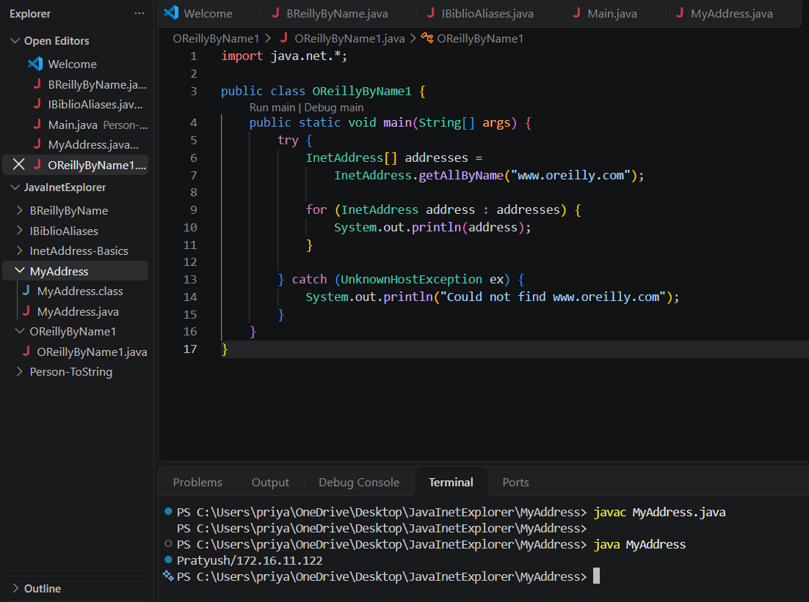

# MyAddress

## Overview
This program demonstrates how to retrieve information about the local machine's network address using Java. It helps understand how a computer can identify itself on a network.

## How It Works
- The program imports the `InetAddress` class from the `java.net` package.
- It uses `InetAddress.getLocalHost()` to retrieve information about the local machine.
- Java identifies the computer's hostname and associated IP address.
- The retrieved information is displayed on the console.

This program is useful for understanding how Java interacts with the local system's network configuration.

## Concepts Used
- Java Networking
- `InetAddress` class
- `getLocalHost()` method
- Hostname and IP address

## Output

